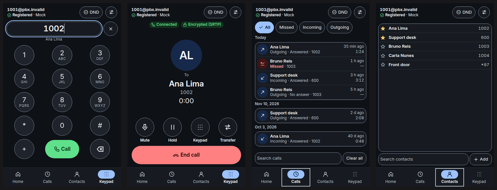
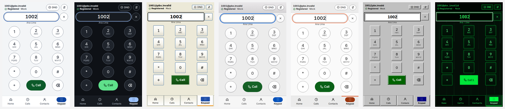
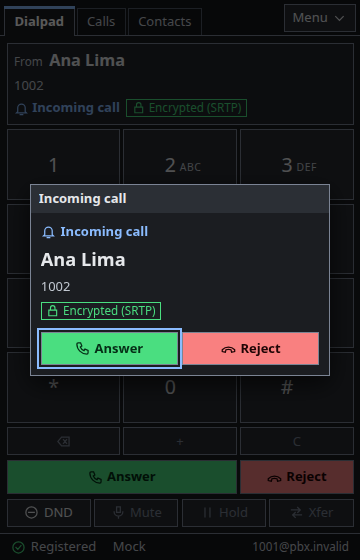
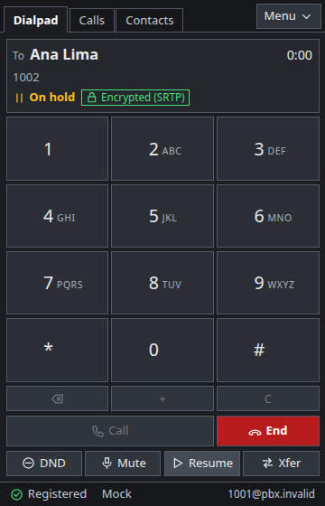
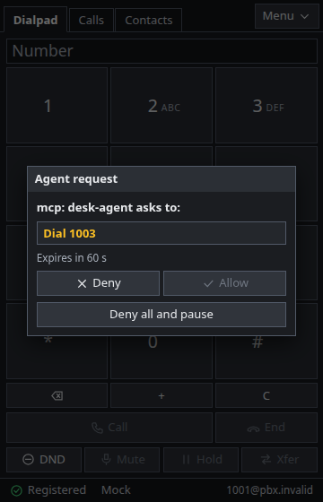
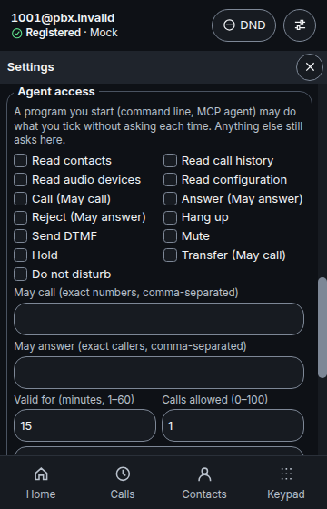
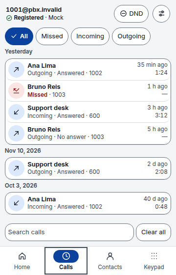

<h1 align="center">go-microsip</h1>

<p align="center">
  <b>The compact SIP softphone you already know how to use.</b><br>
  The MicroSIP layout on Linux and Windows: keypad, call log, contacts, encrypted calls,<br>
  seven skins, and a command line and MCP server for your AI agents. One executable, written in Go.
</p>

<p align="center">
  <a href="https://github.com/jniltinho/go-microsip/releases"></a>
  <a href="https://github.com/jniltinho/go-microsip/actions/workflows/ci.yml"></a>
  <a href="https://github.com/jniltinho/go-microsip/releases"></a>
  <a href="https://go.dev/"></a>
  <a href="LICENSE"></a>
  <a href="https://github.com/jniltinho/go-microsip/stargazers"></a>
</p>

<p align="center">
  <a href="#-try-it-in-one-minute">Try it</a> ·
  <a href="#-screenshots">Screenshots</a> ·
  <a href="#-what-you-get">Features</a> ·
  <a href="#-for-ai-agents-and-scripts">Agents</a> ·
  <a href="docs/README.md">Documentation</a> ·
  <a href="https://github.com/jniltinho/go-microsip/releases">Download</a>
</p>

<p align="center">
  
</p>

## ✨ Why people pick it

- 📞 **Familiar from the first second** — the MicroSIP layout: type a number and press Call. Keypad, call log, contacts and a status bar that says whether you are **Online**.
- 📦 **One file, nothing to install** — an AppImage on Linux, a portable `.zip` on Windows. No Electron and no bundled browser: the window is drawn by the system's own web view.
- 🔒 **Private by default** — TLS signaling and SRTP audio when your PBX has them, the password you type goes to the system's keyring, and is never accepted as an argument or written to a log or the database.
- 🖥️ **At home on your desktop** — tray icon with your last calls, notifications with **Answer** and **Reject**, a ring you can hear, `sip:` and `tel:` links, one instance.
- 🎨 **Your look** — seven skins switched live: Light, Dark, Windows XP, macOS, Ubuntu, Windows 98 and Matrix.
- 🤖 **Ready for AI agents** — a command line and an MCP server let an agent place and answer calls, and nothing happens until you press **Allow** in the window.
- 🧪 **Tested against real PBXs** — its calls are checked against a disposable Asterisk lab and FreePBX 17, and the packaged files on clean Ubuntu, Debian and Windows 11 VMs.
- 🔁 **Coming from rust-microsip?** — one command brings your account, contacts and history over.

## 🚀 Try it in one minute

**Linux** (Ubuntu 26.04 or later, Debian 13; x86_64): download the AppImage from
[Releases](https://github.com/jniltinho/go-microsip/releases), then:

```bash
chmod +x go-microsip-*-x86_64.AppImage
./go-microsip-*-x86_64.AppImage
```

**Windows 11** (preview): download `go-microsip-<version>-windows-amd64.zip`, extract it anywhere and
run `go-microsip.exe`. It is unsigned, so SmartScreen may ask first.

Then open **Settings**, fill in your SIP server, username, domain and password, pick UDP, TCP or
TLS, and save. When the status bar says **Online**, type a number and press **Call**.

Verify what you downloaded with `sha256sum --check --ignore-missing SHA256SUMS`. Requirements,
configuration by file and everything else: **[documentation](docs/README.md)**.

## 📸 Screenshots

**Pick your style** — seven skins, switched live in Settings:

<p align="center">
  
</p>

| Incoming call | Call on hold | Settings |
|---------------|--------------|----------|
|  |  |  |

| Agent approval | Agent access | Call log (light) |
|----------------|--------------|------------------|
|  |  |  |

All screens use fictional data. Every screen in every skin: [docs/prints/go](docs/prints/go/).

## 🧩 What you get

| | |
|---|---|
| **Calls** | One SIP account over UDP, TCP or TLS · G.711 (PCMU/PCMA) · hold, mute, blind transfer, do-not-disturb · RFC 4733 DTMF · ring, ringback, and the audio your PBX plays before it answers |
| **Security** | TLS with the CA bundle you name · SDES-SRTP, optional or mandatory · password in the keyring (Secret Service, Windows Credential Manager) · a window whose page loads nothing from the network |
| **Interface** | Keypad, call history, contacts with favorites and CSV import, status bar · seven skins · keyboard friendly |
| **Desktop** | Tray icon with the last calls · notifications for incoming and missed calls · `sip:` and `tel:` links · single instance |
| **Audio** | PipeWire or PulseAudio on Linux, WASAPI on Windows · devices chosen in Settings · a local audio test |
| **Configuration** | Settings in the window, or a TOML file, a `.env` file and environment variables · `go-microsip doctor` shows where every value came from, without secrets |
| **Agents** | `go-microsip` command line and MCP server · every action waits for **Allow**, or for a scoped, time-limited grant you issue · a headless `service` mode |
| **Everywhere** | Linux x86_64 (AppImage) · Windows 11 x86_64 (preview) · every release with checksums, third-party notices and a bill of materials |

## 🤖 For AI agents and scripts

While the window runs, other local programs can drive it:

```sh
go-microsip status
go-microsip call dial 1002      # waits for "Allow" in the window
go-microsip mcp                 # MCP server for AI agents, on standard input and output
```

Every change waits for **Allow** in the window, unless you issued a scoped, time- and
quota-limited grant in **Settings → Agent access**. `go-microsip service` runs without a window
from a single-use bootstrap exported there. The whole contract:
[Controlling go-microsip](docs/agent-cli-mcp.md).

## 🔁 Coming from rust-microsip

go-microsip is the Go rewrite of rust-microsip, which this repository held until `0.1.0-rc.3`
(now under [archive/rust](archive/rust/README.md), no longer built). Both can be installed side by
side; nothing is imported by itself. With both closed:

```sh
go-microsip import rust-microsip            # a preview; changes nothing
go-microsip import rust-microsip --apply    # --credential also copies the keyring password
```

## 🧭 Good to know

go-microsip is young, and says what it has not proven. Its calls are checked in a lab and in
virtual machines; sound on real sound cards and headsets and much of the desktop integration have
not been checked by a recorded test yet. There is one account and one call at a time, no STUN,
and a TLS account needs its CA bundle named. The details, per system:
[Platforms](docs/README.md#platforms) and [Limits of this version](docs/README.md#limits-of-this-version).

## 📚 Documentation

| | |
|---|---|
| [Documentation guide](docs/README.md) | Install, requirements, configuration, security, skins, platforms, limits, troubleshooting |
| [Controlling go-microsip](docs/agent-cli-mcp.md) | Command line, MCP server, grants, the headless service |
| [Architecture](docs/architecture.md) | The layers from the core to the window, and the security boundaries |
| [Development](docs/DEVELOPMENT.md) | Build in Docker, tests, the lab PBX, the test VMs |
| [Release process](docs/release.md) | How a version is built, checked and published |
| [Adding a skin](docs/themes.md) | One stylesheet and one registry entry |

**Built with** Go · Wails v3 · sipgo and diago · Vue 3 · Vite+ · Tailwind CSS

```sh
make image && make check && make test && make dist    # only Docker and make on the host
```

## ⭐ Support the project

If go-microsip is useful to you, **star the repository**: it helps other people find it. Issues
and pull requests are welcome; start with the [development guide](docs/DEVELOPMENT.md).

## License

GPL-3.0-or-later; see [LICENSE](LICENSE). Third-party notices ship with every release.
go-microsip is an independent project inspired by [MicroSIP](https://www.microsip.org/); it is
not affiliated with or endorsed by MicroSIP, and uses the name only to describe the interface.
