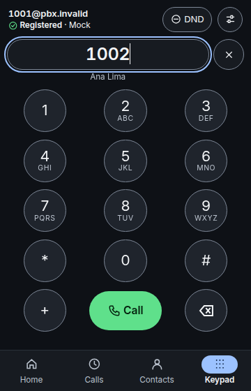
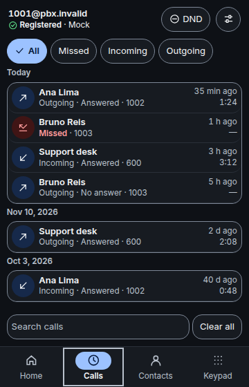
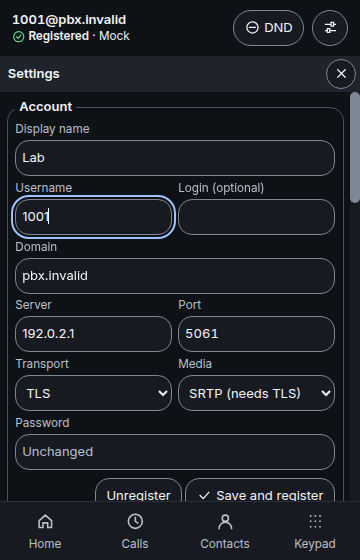
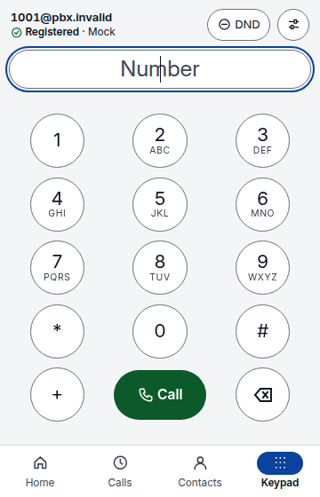
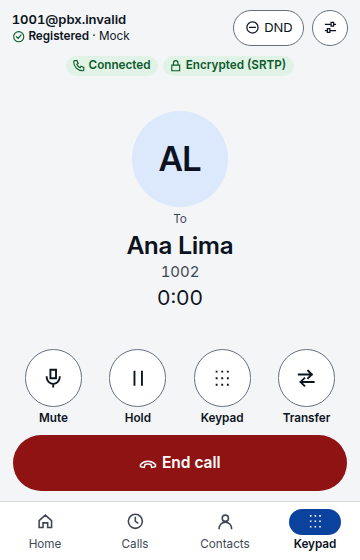
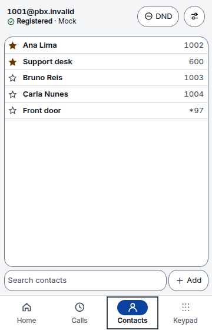

<div align="center">


# go-microsip

**A compact SIP softphone for Linux and Windows, written in Go, with the MicroSIP layout you already know.**

[](https://github.com/jniltinho/go-microsip/releases)
[](https://github.com/jniltinho/go-microsip/actions/workflows/ci.yml)
[](LICENSE)

[Install](#install) · [Quick start](#quick-start) · [Screenshots](#screenshots) · [CLI and MCP](#cli-and-mcp) · [Platforms](#platforms) · [Limits](#limits-of-this-version) · [Build](#build-from-source) · [Docs](#documentation)

</div>

## Why go-microsip

MicroSIP is loved for being small, fast and simple, but it is a Windows program. go-microsip
brings the same idea to the Linux desktop, and to Windows, as one executable: the familiar layout
of keypad, call log, contacts and a status bar that shows whether you are **Online**, in a window
drawn by the system's own web view (WebKitGTK on Linux, WebView2 on Windows): no browser is
bundled, and the window's page loads nothing from the network.

Calls are encrypted when your PBX supports it (TLS signaling with SRTP), the password stays in the
system's keyring, and AI agents can place or answer calls through a local command line and an MCP
server only with your explicit approval.

go-microsip is the Go rewrite of **rust-microsip**, the application this repository held until
version 0.1.0-rc.3. The Rust code is kept under [archive/rust](archive/rust/README.md) as a
reference and is no longer built or released.

go-microsip is an independent project inspired by [MicroSIP](https://www.microsip.org/). It is not
affiliated with or endorsed by MicroSIP.

## Features

| Area | What you get |
|---|---|
| **Calls** | One SIP account over UDP, TCP or TLS; G.711 (PCMU/PCMA); hold, mute, blind transfer, do-not-disturb; RFC 4733 DTMF; a ring for incoming calls and a ringback tone while the other side rings, or the audio the PBX plays before it answers |
| **Security** | TLS with the CA bundle you name (`ca_file`); SDES-SRTP, optional or mandatory; the password never goes in arguments, logs or the database |
| **Interface** | MicroSIP-like window: keypad, call history, contacts with favorites and CSV import, status bar; seven skins (Light, Dark, Windows XP, macOS, Ubuntu, Windows 98, Matrix) |
| **Desktop** | Tray icon whose menu lists your last calls; closing the window keeps it in the tray; a notification with Answer/Reject for an incoming call and one for a missed call; `sip:`/`tel:` link handler; single instance |
| **Audio** | PipeWire or PulseAudio on Linux, WASAPI on Windows; devices chosen in the settings, with a local audio test; devices opened only during calls |
| **Configuration** | Settings in the window, or TOML, `.env` and environment with a clear precedence; `go-microsip doctor` shows where every value came from, without secrets |
| **Agents** | `go-microsip` command line and `go-microsip mcp`: every action waits for **Allow** in the window unless you issue a scoped, revocable grant; a headless `service` mode |

Status: **pre-release** ([latest](https://github.com/jniltinho/go-microsip/releases)). Calls are
tested against a disposable Asterisk lab and a FreePBX 17 VM, and the packaged application on clean
Ubuntu 26.04, Debian 13 and Windows 11 VMs. Sound on real sound cards and headsets, and most of the
desktop integration on real machines, have not been checked by a recorded test yet: see
[Limits of this version](#limits-of-this-version) and the
[release notes](docs/release/v0.2.0-rc.1.md).

## Screenshots

<table>
  <tr>
    <th>Keypad (dark)</th>
    <th>Call log (dark)</th>
    <th>Settings (dark)</th>
  </tr>
  <tr>
    <td></td>
    <td></td>
    <td></td>
  </tr>
  <tr>
    <th>Keypad (light)</th>
    <th>Call in progress (light)</th>
    <th>Contacts (light)</th>
  </tr>
  <tr>
    <td></td>
    <td></td>
    <td></td>
  </tr>
</table>

All screens use fictional data. Every screen in every skin is under [docs/prints/go](docs/prints/go/).

## Install

Download from the [releases page](https://github.com/jniltinho/go-microsip/releases):

- `go-microsip-<version>-x86_64.AppImage` (Linux): make it executable and run it.
- `go-microsip-<version>-linux-amd64`: the same program as a plain executable.
- `go-microsip-<version>-windows-amd64.zip` (Windows, preview): a portable folder with the program,
  the license and the third-party notices. `go-microsip-<version>-windows-amd64.exe` is the
  program alone. Both are unsigned, so SmartScreen may warn you; check them with
  `Get-FileHash <file> -Algorithm SHA256` first.

Verify a download with `sha256sum --check --ignore-missing SHA256SUMS`. What each system needs is
under [Platforms](#platforms).

## Quick start

1. Start go-microsip and open **Settings**.
2. Fill in the SIP server, the username, the domain and the password, and pick UDP, TCP or TLS.
3. Save. The status bar says **Online** once the account is registered.
4. Type a number and press **Call**, or pick an entry in **Calls** or **Contacts**.

Prefer a file? Create `$XDG_CONFIG_HOME/go-microsip/config.toml` (`%APPDATA%\go-microsip\config.toml`
on Windows):

```toml
schema = 1

[account]
username = "1001"
domain = "sip.example.invalid"
server = "sip.example.invalid"
transport = "tls"        # udp | tcp | tls
media = "srtp"           # rtp | srtp (srtp requires tls)
ca_file = "/etc/ssl/certs/ca-certificates.crt"
password_env = "GO_MICROSIP_SIP_PASSWORD"
```

Export the password in the environment variable that `password_env` names before starting;
passwords are never accepted as command-line arguments. `go-microsip doctor` prints a sanitized
report of the effective configuration, the display and the sound, `go-microsip config validate`
and `config export` check and print the configuration without secrets, and `go-microsip --help`
lists every command.

## CLI and MCP

While the window runs, other local programs can drive it:

```sh
go-microsip status
go-microsip call dial 1002      # waits for "Allow" in the window
go-microsip mcp                 # MCP server for AI agents, on standard input and output
```

Every change waits for **Allow** in the window, unless you issued a scoped, time- and quota-limited
grant in **Settings → Agent access**. `go-microsip service` runs without a window from a
single-use bootstrap exported there. See [Controlling go-microsip](docs/agent-cli-mcp.md).

## Coming from rust-microsip

Both applications can be installed and run by the same user: each has its own name, settings,
database, lock and control socket, and neither touches the other's files. Nothing is imported by
itself; to bring rust-microsip's account, contacts and history over, with both closed:

```sh
go-microsip import rust-microsip            # a preview; changes nothing
go-microsip import rust-microsip --apply    # --credential also copies the keyring password
```

## Platforms

- **The AppImage without FUSE.** `go-microsip-<version>-x86_64.AppImage` is run directly
  where FUSE is available. Where it is not (a container, a minimal installation), run it
  with `APPIMAGE_EXTRACT_AND_RUN=1` in the environment, or with `--appimage-extract-and-run`
  as its first argument: it unpacks itself to a temporary folder and runs from there. The
  project's own checks in containers and in the test VMs run it this way.
- **Linux** (Ubuntu 26.04 and later, Debian 13; x86_64). The window uses the system's GTK 4 and
  WebKitGTK 6.0 (`libgtk-4-1`, `libwebkitgtk-6.0-4`), which the default GNOME desktop of both
  already has and another desktop may have to install, and the desktop's sound service (PipeWire
  or PulseAudio). `go-microsip --safe-gpu` starts it without GPU acceleration, which a
  virtual machine may need.
  - A password typed in Settings is kept in the desktop keyring (Secret Service) and nowhere
    else. Without a keyring, or with a locked one, it lasts for the session and is asked for
    again at the next start; that is also the case of a user who logs in without a password.
    `account.password_env` or a private `account.password_file` avoid the prompt.
  - An incoming call rings on the speaker chosen for calls and is shown as a desktop
    notification with **Answer** and **Reject** where the notification service offers buttons.
    With do-not-disturb on, nothing rings.
  - On a desktop with a tray (KDE, Ubuntu's GNOME) the close button hides the window to the tray
    icon, whose menu lists the latest calls; without one, the close button quits, asking first
    during a call.
  - `sip:` and `tel:` links open go-microsip, which asks before it calls. Making it the default
    handler is your choice in the desktop's settings.
  - The command line, the MCP server and the headless service work here:
    [Controlling go-microsip](docs/agent-cli-mcp.md).
- **Windows 11** (preview; x86_64). Windows 10 needs the WebView2 runtime, which Windows 11
  brings, and is not tested. The window opens with its settings,
  contacts and history, and the password is kept in the Credential Manager, where it outlives
  the application's folder. The close button hides the window to the notification area; a
  `sip:` or `tel:` link can be opened with go-microsip, which asks before it calls, once you
  choose it in Settings, Default apps; an incoming call is also a Windows notification with
  **Answer** and **Reject**; and the command line reaches the window as on Linux (the MCP
  server and the headless service are not tried on Windows yet). Calls over UDP and TCP are checked in a Windows VM against a lab PBX, with audio
  as packets both ways; sound on a real sound card, TLS and SRTP are not verified on Windows
  yet. At the first call Windows asks whether its firewall should let go-microsip accept
  connections: calls, incoming ones included, work whichever you answer.
- **macOS**: not built.

## Limits of this version

Known, and accepted for this pre-release:

- **The network.** There is no STUN and no SIP keepalive: nothing is sent between two
  renewals of a registration to keep its path open (a call that only receives does send a
  frame of silence a second, see "Audio before the answer"). Calls work with a PBX that keeps the
  audio passing through itself and answers to the address packets come from (symmetric RTP),
  which is how the lab's Asterisk is set and what a default FreePBX extension asks for; a PBX
  that expects the softphone to know its public address is not supported. Behind a home
  router this was not tried yet.
- **One account**, and one call at a time.
- **Sound.** There is no volume in the window (the system's mixer has one for each
  application). A sound device chosen in the settings is used by the next call, and a call in
  progress keeps the ones it began with; the settings' audio test uses it at once: a tone on the chosen speaker and the level of the
  chosen microphone, for ten seconds or until it is stopped, and never during a call. The ring and the ringback are tones the softphone makes itself, on the speaker
  chosen for calls: there is no ringtone file to choose and no speaker of its own for ringing.
- **Audio before the answer.** What a PBX plays before a call is answered (early media: an
  operator's own ringing tone, or a message such as "this number is unavailable") is played
  in place of the softphone's ringback tone. Nothing of the microphone is sent before the
  answer or on hold; one frame of silence a second is. One VPN gateway was seen to close its
  tunnel after about twelve seconds that carried the other side's audio alone, and held
  with this frame: that is one installation's behavior, not a guarantee for others. With an account that
  requires SRTP, audio before the answer that is not encrypted is not played.
- **A call answered on another phone.** When a PBX rings this softphone and another phone
  of the same extension, and the other one answers, the call is not notified as missed and
  is listed as answered, with no duration. This rests on the PBX saying why it stopped
  ringing (the Reason header of its CANCEL, as Asterisk and FreePBX send it); from a PBX
  that does not say, such a call is a missed one.
- **A PBX without RFC 4733 keys.** A call whose answer does not agree to `telephone-event`
  has its audio; keys pressed during it are refused, and nothing is sent in their place.
- **A call nobody answers** ends after 60 seconds.
- **TLS needs a CA file.** A TLS account registers only with a CA bundle named in its
  settings (`ca_file`): the system's certificates are not used, so a PBX whose certificate
  comes from a public authority needs that authority's bundle named too. Without one the
  window says "certificate rejected". rust-microsip, the application this one replaced, used
  the system's certificates when no bundle was named.
- **Signaling from the PBX alone.** An account over UDP reads nothing that does not come,
  at the account's port, from an address the server's name has answered with since the
  account connected: the name is resolved then, and again when something arrives from
  another address at that port, and an address it once had is kept until the account
  connects again. A PBX that answers from another port than the account's, or that sends
  its calls from an address its name never answers with, is not heard. An account over TCP
  or TLS listens on nothing and reads only the connections it opened itself; a request that
  arrives on one of them from another address or port is refused once it is read, with one
  exception that is the SIP library's: a CANCEL that matches a call ringing here is obeyed
  before that check, so a host the softphone connected to for an earlier call (a PBX that
  names another host as a call's Contact) could stop a later call's ringing.
- **A server name with several addresses.** Each request is sent to the address the name
  has at that moment, and the cancellation of a call is addressed separately from the call:
  with a name whose answer changes in between, a call canceled while it rings can ring on at
  the server that got it. Not seen with one PBX behind one name.
- **A network that goes away.** When the address the account registered from leaves the
  machine (a VPN that dropped, a cable pulled), the window says so within a few seconds and
  the account registers again by itself once the network is back: tried after 5 s, then at
  doubling delays, eight times; after that, "Register" in the window.
- **A transfer that the PBX accepts and then fails.** FreePBX takes the other party away
  before it reports the failure: go-microsip says the transfer failed and stays in a call
  with nobody in it until you hang up.
- **Secure media.** Unencrypted RTP is used unless SRTP is chosen for the account, and every
  call says which one it has. Three protections of rust-microsip's own SRTP code are
  not in the library used here: the receiver bound to one source, the stop before the packet
  counter runs out, and the bounded list of unauthenticated sources.
- **Builds.** The build image pins its base by digest but not every package and tool in it.

`go-microsip doctor` prints a sanitized report of the configuration, the display and the sound;
`go-microsip --help` lists every command.

## Build from source

Only Docker and make are needed; Go and Node run inside a pinned build image, never on the host.

```sh
make image                 # the build image, once
make check                 # gofmt and go vet for every build
make test                  # unit tests with the race detector
make dist                  # dist/go: Linux binary, AppImage, Windows .exe and .zip, notices, SBOM, SHA256SUMS
make lab                   # calls against a disposable Asterisk lab
```

The [development guide](docs/DEVELOPMENT.md) covers the layout, the lab, the test VMs and the
release process.

## Documentation

- [Documentation index](docs/README.md): guides, records and receipts.
- [Architecture](docs/architecture.md): the layers from the core to the window.
- [Controlling go-microsip](docs/agent-cli-mcp.md): command line, MCP, grants and the headless service.
- [Adding a skin](docs/themes.md).
- [Development guide](docs/DEVELOPMENT.md) and [release process](docs/release.md).
- [The migration from Rust](openspec/changes/migrate-to-go-wails/proposal.md): the plan, its
  [tasks](openspec/changes/migrate-to-go-wails/tasks.md), the
  [parity matrix](docs/migration/parity-matrix.md) and the [receipts](docs/receipts/).

## License

GPL-3.0-or-later. Third-party notices ship with every release. The MicroSIP name is used only to
describe the interface this project is inspired by.
