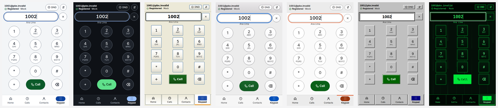

# go-microsip documentation

The [project README](../README.md) is the short tour. This guide covers installation, requirements,
configuration, security, skins, what each system supports, the limits of this version and
troubleshooting.

| Topic | Where |
|-------|-------|
| Command line, MCP server, grants, the headless service | [agent-cli-mcp.md](agent-cli-mcp.md) |
| Layers, runtime model, security boundaries | [architecture.md](architecture.md) |
| Building in Docker, tests, the lab PBX, the test VMs | [DEVELOPMENT.md](DEVELOPMENT.md) |
| How a version is built, checked and published | [release.md](release.md), notes per version in [release/](release/) |
| Adding a skin; the frontend | [themes.md](themes.md), [ui/go-frontend.md](ui/go-frontend.md) |
| What was compared with rust-microsip, and the owner's decisions | [migration/](migration/) |
| Evidence of each verified milestone; independent reviews | [receipts/](receipts/), [reviews/](reviews/) |
| Every screen in every skin | [prints/go/](prints/go/) |

**Contents:** [Install](#install) · [First call](#first-call) · [Configuration](#configuration) ·
[Passwords and security](#passwords-and-security) · [Sound](#sound) · [Skins](#skins) ·
[Desktop integration](#desktop-integration) · [Agents and scripts](#agents-and-scripts) ·
[Coming from rust-microsip](#coming-from-rust-microsip) · [Platforms](#platforms) ·
[Limits of this version](#limits-of-this-version) · [Troubleshooting](#troubleshooting) ·
[Quality checks](#quality-checks) · [Project status](#project-status) · [Records](#records)

---

## Install

Every version is on the [releases page](https://github.com/jniltinho/go-microsip/releases), with
`SHA256SUMS`, the third-party notices and a bill of materials.

### Linux: AppImage

For Ubuntu 26.04 or later and Debian 13, x86_64. It needs the system's GTK 4 and WebKitGTK 6.0
(`libgtk-4-1`, `libwebkitgtk-6.0-4`), which the default GNOME desktop of both already has, and
PipeWire or PulseAudio.

```bash
sha256sum --check --ignore-missing SHA256SUMS
chmod +x go-microsip-<version>-x86_64.AppImage
./go-microsip-<version>-x86_64.AppImage
```

Without FUSE (a container, a minimal installation) run it with `APPIMAGE_EXTRACT_AND_RUN=1` in the
environment, or with `--appimage-extract-and-run` as its first argument.

### Linux: plain executable

`go-microsip-<version>-linux-amd64` is the same program without the AppImage around it. Make it
executable and run it; the requirements are the same.

### Windows

For Windows 11, x86_64 (preview). `go-microsip-<version>-windows-amd64.zip` is a portable folder
with the program, the license and the third-party notices: extract it anywhere and run
`go-microsip.exe`. `go-microsip-<version>-windows-amd64.exe` is the program alone. There is no
installer. The files are unsigned, so SmartScreen may show "Windows protected your PC"; check the
download first:

```powershell
Get-FileHash .\go-microsip-<version>-windows-amd64.zip -Algorithm SHA256
```

### From source

Only Docker and make are needed; Go and Node run in a pinned build image.

```bash
git clone https://github.com/jniltinho/go-microsip.git && cd go-microsip
make image && make dist        # dist/go: every artifact, with checksums
```

The [developer guide](DEVELOPMENT.md) has every target.

## First call

1. Start go-microsip and open **Settings**.
2. Fill in the SIP server, the username, the domain and the password, and pick UDP, TCP or TLS.
   For TLS, also name the CA bundle that signed your PBX's certificate.
3. Save. The status bar says **Online** once the account is registered.
4. Type a number and press **Call**, or pick an entry in **Calls** or **Contacts**.

During a call: mute, hold, the keypad for DTMF, and blind transfer. Do-not-disturb is the **DND**
button at the top; with it on, incoming calls are refused and nothing rings.

## Configuration

The window's settings are enough for most people. Everything can also come from files and the
environment. Each field is resolved on its own, and the first source that has it wins:

1. the command line (`--config`, `--env-file` choose the files below);
2. environment variables, `GO_MICROSIP_<SECTION>_<KEY>` (for example `GO_MICROSIP_ACCOUNT_SERVER`);
3. a `.env` file, only when named with `--env-file` (the current folder is never searched);
4. one TOML file: `$XDG_CONFIG_HOME/go-microsip/config.toml` (`~/.config` when unset,
   `%APPDATA%\go-microsip\config.toml` on Windows), or the one named with `--config`;
5. what you saved in the window (kept in the database);
6. built-in defaults.

```toml
schema = 1

[account]
display_name = "Ana Lima"
username = "1001"
domain = "sip.example.invalid"
server = "sip.example.invalid"   # defaults to the domain
transport = "tls"                # udp | tcp | tls
media = "srtp"                   # rtp | srtp (srtp requires tls)
ca_file = "/etc/ssl/certs/ca-certificates.crt"
password_env = "GO_MICROSIP_SIP_PASSWORD"

[ui]
theme = "system"                 # system, light, dark, xp, macos, ubuntu, win98, matrix
```

| Key | Meaning |
|-----|---------|
| `account.display_name`, `account.username`, `account.auth_username`, `account.domain` | Who you are on the PBX; `auth_username` only when it differs from the username |
| `account.server`, `account.port`, `account.transport` | Where to register; the port defaults to the transport's |
| `account.media` | `rtp` or `srtp`; `srtp` refuses a call that would not be encrypted |
| `account.expires` | Registration lifetime in seconds (300 by default) |
| `account.password_env`, `account.password_file` | Where the password comes from when not typed in the window |
| `account.ca_file` | Absolute path of the PEM CA bundle a TLS account trusts |
| `ui.theme`, `ui.dnd` | The skin, and do-not-disturb |
| `audio.input_device`, `audio.output_device` | The microphone and the speaker for calls |

Check your configuration without starting the softphone:

```bash
go-microsip doctor              # where every value came from, the display and the sound; no secrets
go-microsip config validate     # is it complete and valid?
go-microsip config export       # the effective configuration, without secrets
```

A configuration, `.env` or CA file that other users can write is refused: someone else could
change your PBX or your trusted certificates.

## Passwords and security

- **The password is never an argument.** Any option that looks like one is refused. A password
  typed in the window is kept in the system's keyring (the Secret Service on Linux, the Credential
  Manager on Windows) and nowhere else. Without a keyring, or with a locked one, it lasts for the
  session and is asked for again at the next start.
- **For unattended use**, `account.password_env` names an environment variable, and
  `account.password_file` a private file (yours alone, not a link).
- **TLS** trusts only the CA bundle named in `account.ca_file`.
- **SRTP** is used when `account.media` is `srtp`; every call shows whether it is encrypted, and
  with `srtp` a call that cannot be encrypted is refused instead of downgraded.
- **The window's page** is embedded in the program and loads nothing from the network.
- **Agents** act only with your approval or a grant you issued: see
  [Agents and scripts](#agents-and-scripts).

What is and is not protected is described in [architecture.md](architecture.md#security-boundaries),
and the stated exceptions are under [Limits of this version](#limits-of-this-version).

## Sound

Choose the microphone and the speaker in **Settings**; "System default" follows your desktop. A
choice applies to the next call. The settings' audio test plays a tone on the chosen speaker and
shows the level of the chosen microphone for ten seconds, without a call. An incoming call rings
on the speaker chosen for calls, and an outgoing one plays a ringback tone, or the audio your PBX
sends before it answers. There is no echo cancellation: use a headset.

## Skins

Seven skins, chosen in **Settings** and applied at once: Light, Dark, Windows XP, macOS, Ubuntu,
Windows 98 and Matrix; "System" follows the desktop's light or dark preference. All fonts are
bundled. Writing a new one is one stylesheet and one registry entry: [themes.md](themes.md).

<p align="center">
  
</p>

## Desktop integration

- **Tray.** Where the desktop has a tray (KDE, Ubuntu's GNOME, Windows), the close button hides
  the window to the tray icon, whose menu lists the latest calls. Without one it quits, asking
  first during a call.
- **Notifications.** An incoming call is a notification with **Answer** and **Reject** where the
  notification service offers buttons; a call that rang and was not answered leaves a missed-call
  notification.
- **Links.** `sip:` and `tel:` links open go-microsip, which asks before it calls. Making it the
  default handler is your choice in the desktop's settings.
- **One instance.** A link opened while go-microsip runs goes to the window that is running; a
  second softphone on the same profile does not start.

## Agents and scripts

```sh
go-microsip status
go-microsip call dial 1002      # waits for "Allow" in the window
go-microsip mcp                 # MCP server for AI agents, on standard input and output
```

Every change waits up to 60 seconds for **Allow** or **Deny** in the window, unless a grant you
created in **Settings → Agent access** covers it: a grant names what a program may do, which
numbers it may call, for how long and how many times, and can be revoked. `go-microsip service`
runs without a window from a single-use bootstrap exported there. The contract, the exit codes
and the MCP tools: [agent-cli-mcp.md](agent-cli-mcp.md).

## Coming from rust-microsip

go-microsip replaced rust-microsip in this repository on 2026-11-13; the Rust code is kept under
[archive/rust](../archive/rust/README.md) and is no longer built or released. Both applications
can be installed and run by the same user: each has its own name, settings, database, lock and
control socket. Nothing is imported by itself; with both closed:

```sh
go-microsip import rust-microsip            # a preview; changes nothing
go-microsip import rust-microsip --apply    # --credential also copies the keyring password
```

`RUST_MICROSIP_` environment variables are not read; `go-microsip doctor` lists the ones it finds.
What go-microsip does differently on purpose is in the
[parity decisions](migration/parity-decisions.md).

## Platforms

- **The AppImage without FUSE.** `go-microsip-<version>-x86_64.AppImage` is run directly
  where FUSE is available. Where it is not (a container, a minimal installation), run it
  with `APPIMAGE_EXTRACT_AND_RUN=1` in the environment, or with `--appimage-extract-and-run`
  as its first argument: it unpacks itself to a temporary folder and runs from there. The
  project's own checks in containers and in the test VMs run it this way.
- **Linux** (Ubuntu 26.04 and later, Debian 13; x86_64). The window uses the system's GTK 4 and
  WebKitGTK 6.0 (`libgtk-4-1`, `libwebkitgtk-6.0-4`), which the default GNOME desktop of both
  already has and another desktop may have to install, and the desktop's sound service (PipeWire
  or PulseAudio). `go-microsip --safe-gpu` starts it without GPU acceleration, which a
  virtual machine may need.
  - A password typed in Settings is kept in the desktop keyring (Secret Service) and nowhere
    else. Without a keyring, or with a locked one, it lasts for the session and is asked for
    again at the next start; that is also the case of a user who logs in without a password.
    `account.password_env` or a private `account.password_file` avoid the prompt.
  - An incoming call rings on the speaker chosen for calls and is shown as a desktop
    notification with **Answer** and **Reject** where the notification service offers buttons.
    With do-not-disturb on, nothing rings.
  - On a desktop with a tray (KDE, Ubuntu's GNOME) the close button hides the window to the tray
    icon, whose menu lists the latest calls; without one, the close button quits, asking first
    during a call.
  - `sip:` and `tel:` links open go-microsip, which asks before it calls. Making it the default
    handler is your choice in the desktop's settings.
  - The command line, the MCP server and the headless service work here:
    [Controlling go-microsip](agent-cli-mcp.md).
- **Windows 11** (preview; x86_64). Windows 10 needs the WebView2 runtime, which Windows 11
  brings, and is not tested. The window opens with its settings,
  contacts and history, and the password is kept in the Credential Manager, where it outlives
  the application's folder. The close button hides the window to the notification area; a
  `sip:` or `tel:` link can be opened with go-microsip, which asks before it calls, once you
  choose it in Settings, Default apps; an incoming call is also a Windows notification with
  **Answer** and **Reject**; and the command line reaches the window as on Linux (the MCP
  server was checked in a Windows VM against a running window; the headless service is not
  tried on Windows yet). Calls over UDP and TCP are checked in a Windows VM against a lab PBX, with audio
  as packets both ways; sound on a real sound card, TLS and SRTP are not verified on Windows
  yet. At the first call Windows asks whether its firewall should let go-microsip accept
  connections: calls, incoming ones included, work whichever you answer.
- **macOS**: not built.

## Limits of this version

Known, and accepted for this pre-release:

- **The network.** There is no STUN and no SIP keepalive: nothing is sent between two
  renewals of a registration to keep its path open (a call that only receives does send a
  frame of silence a second, see "Audio before the answer"). Calls work with a PBX that keeps the
  audio passing through itself and answers to the address packets come from (symmetric RTP),
  which is how the lab's Asterisk is set and what a default FreePBX extension asks for; a PBX
  that expects the softphone to know its public address is not supported. Behind a home
  router this was not tried yet.
- **One account**, and one call at a time.
- **Sound.** There is no volume in the window (the system's mixer has one for each
  application). A sound device chosen in the settings is used by the next call, and a call in
  progress keeps the ones it began with; the settings' audio test uses it at once: a tone on the chosen speaker and the level of the
  chosen microphone, for ten seconds or until it is stopped, and never during a call. The ring and the ringback are tones the softphone makes itself, on the speaker
  chosen for calls: there is no ringtone file to choose and no speaker of its own for ringing.
- **Audio before the answer.** What a PBX plays before a call is answered (early media: an
  operator's own ringing tone, or a message such as "this number is unavailable") is played
  in place of the softphone's ringback tone. Nothing of the microphone is sent before the
  answer or on hold; one frame of silence a second is. One VPN gateway was seen to close its
  tunnel after about twelve seconds that carried the other side's audio alone, and held
  with this frame: that is one installation's behavior, not a guarantee for others. With an account that
  requires SRTP, audio before the answer that is not encrypted is not played.
- **A call answered on another phone.** When a PBX rings this softphone and another phone
  of the same extension, and the other one answers, the call is not notified as missed and
  is listed as answered, with no duration. This rests on the PBX saying why it stopped
  ringing (the Reason header of its CANCEL, as Asterisk and FreePBX send it); from a PBX
  that does not say, such a call is a missed one.
- **A PBX without RFC 4733 keys.** A call whose answer does not agree to `telephone-event`
  has its audio; keys pressed during it are refused, and nothing is sent in their place.
- **A call nobody answers** ends after 60 seconds.
- **TLS needs a CA file.** A TLS account registers only with a CA bundle named in its
  settings (`ca_file`): the system's certificates are not used, so a PBX whose certificate
  comes from a public authority needs that authority's bundle named too. Without one the
  window says "certificate rejected". rust-microsip, the application this one replaced, used
  the system's certificates when no bundle was named.
- **Signaling from the PBX alone.** An account over UDP reads nothing that does not come,
  at the account's port, from an address the server's name has answered with since the
  account connected: the name is resolved then, and again when something arrives from
  another address at that port, and an address it once had is kept until the account
  connects again. A PBX that answers from another port than the account's, or that sends
  its calls from an address its name never answers with, is not heard. An account over TCP
  or TLS listens on nothing and reads only the connections it opened itself; a request that
  arrives on one of them from another address or port is refused once it is read, with one
  exception that is the SIP library's: a CANCEL that matches a call ringing here is obeyed
  before that check, so a host the softphone connected to for an earlier call (a PBX that
  names another host as a call's Contact) could stop a later call's ringing.
- **A server name with several addresses.** Each request is sent to the address the name
  has at that moment, and the cancellation of a call is addressed separately from the call:
  with a name whose answer changes in between, a call canceled while it rings can ring on at
  the server that got it. Not seen with one PBX behind one name.
- **A network that goes away.** When the address the account registered from leaves the
  machine (a VPN that dropped, a cable pulled), the window says so within a few seconds and
  the account registers again by itself once the network is back: tried after 5 s, then at
  doubling delays, eight times; after that, "Register" in the window.
- **A transfer that the PBX accepts and then fails.** FreePBX takes the other party away
  before it reports the failure: go-microsip says the transfer failed and stays in a call
  with nobody in it until you hang up.
- **Secure media.** Unencrypted RTP is used unless SRTP is chosen for the account, and every
  call says which one it has. Three protections of rust-microsip's own SRTP code are
  not in the library used here: the receiver bound to one source, the stop before the packet
  counter runs out, and the bounded list of unauthenticated sources.
- **Builds.** The build image pins its base by digest but not every package and tool in it.

`go-microsip doctor` prints a sanitized report of the configuration, the display and the sound;
`go-microsip --help` lists every command.

## Troubleshooting

| Symptom | What to try |
|---------|-------------|
| The window is blank or does not open in a virtual machine | `go-microsip --safe-gpu` starts it without GPU acceleration |
| The AppImage says it cannot mount (no FUSE) | `APPIMAGE_EXTRACT_AND_RUN=1 ./go-microsip-<version>-x86_64.AppImage` |
| The window does not open on another desktop than GNOME | Install GTK 4 and WebKitGTK 6.0 (`libgtk-4-1`, `libwebkitgtk-6.0-4`) |
| "certificate rejected" on a TLS account | Name the CA bundle that signed the PBX's certificate in `account.ca_file`; the system's certificates are not used |
| The password is asked at every start | There is no keyring, or it is locked; use `account.password_env` or a private `account.password_file` |
| Registered, but calls have no audio | The PBX must keep the audio passing through itself and answer to the address packets come from; there is no STUN (see the limits above) |
| Not sure which value is in effect | `go-microsip doctor` prints every field with its source, the display and the sound service |
| A command answers `engine_unavailable` | The command line talks to a running go-microsip; start the window or the service first |

`go-microsip --help` lists every command.

## Quality checks

Every push to `main` runs, in a pinned build image: the publication scan (no secret, no personal
path, no local-only file), gofmt and `go vet` for every build, the unit tests with the race
detector (including the layering rules), the frontend's checks, the artifacts, the headless checks
and the window's self-test on the built files, and a smoke of the Windows files on a Windows
runner. A release publishes exactly the files that run built. Calls are checked outside CI:
against a disposable Asterisk lab, FreePBX 17 in a VM, and on clean Ubuntu, Debian and Windows 11
VMs. The receipts of those runs are under [receipts/](receipts/), and a review, a build or a
screenshot is never counted as evidence that a call works.

## Project status

**Pre-release.** [`v0.2.0-rc.1`](release/v0.2.0-rc.1.md) is the first version of go-microsip, the
Go application that replaced rust-microsip on 2026-11-13. Its notes say what was checked and what
was not. Progress is tracked by the task list of the
[migration change](../openspec/changes/migrate-to-go-wails/tasks.md), which checks a task only
when its criteria have evidence. What is open for a final `v0.2.0`:

| Area | Open | Where |
| --- | --- | --- |
| Real machines | The manual checklist: sound cards and headsets, five-minute calls per codec, KDE, a real Windows machine, a home router | task 7.2, [the sheet to fill in](release/manual-checklist.md) |
| Parity | 83 of the 140 behaviors compared with rust-microsip are partly shown or not shown | [matrix](migration/parity-matrix.md), [sign-off](migration/parity-signoff.md) |
| Decisions | The system's certificates for TLS, and an unknown skin in the configuration | [sign-off](migration/parity-signoff.md), S4a and S4b |
| First milestone | Three measurements never completed as written | tasks 2.1, 2.8, 2.10 |

## Records

- [Migration](migration/): the parity matrix against rust-microsip, the owner's decisions on its
  differences, and the sign-off of the gate.
- [Receipts](receipts/): evidence of each verified milestone (commands, hashes, measurements and
  limits). The ones named `go-*` are go-microsip's.
- [Reviews](reviews/): independent static reviews and their verdicts. A review is not evidence
  that a call works. The folders named `migrate-to-go-wails-*` are go-microsip's.
- [Screens](prints/go/): every screen in every skin, with fictional data.

## Records of rust-microsip

The Rust application is under [archive/rust](../archive/rust/README.md), with its own guides in
`archive/rust/docs/`. What it left in this folder is kept as history and describes that
application, with the paths its files had before the move: the
[architecture decision records](adr/), the receipts and reviews that are not named after the Go
migration, the notes of `v0.1.0-rc.1` to `rc.3` and the `v0.1.0` draft under [release/](release/),
[implementation-approval.md](implementation-approval.md),
[implementation-checkpoints.md](implementation-checkpoints.md),
[development-skills.md](development-skills.md), [reference-sources.md](reference-sources.md),
[secure-call-experiment.md](secure-call-experiment.md), [ui/g0-native-ui.md](ui/g0-native-ui.md),
[inventory/](inventory/), the screens under [prints/](prints/) outside `prints/go/`, and the
Rust-era changes under `openspec/changes/`, which the migration superseded.
