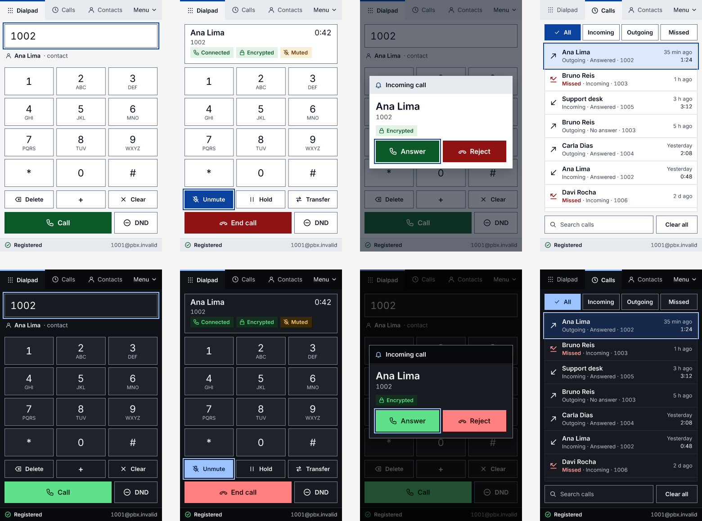
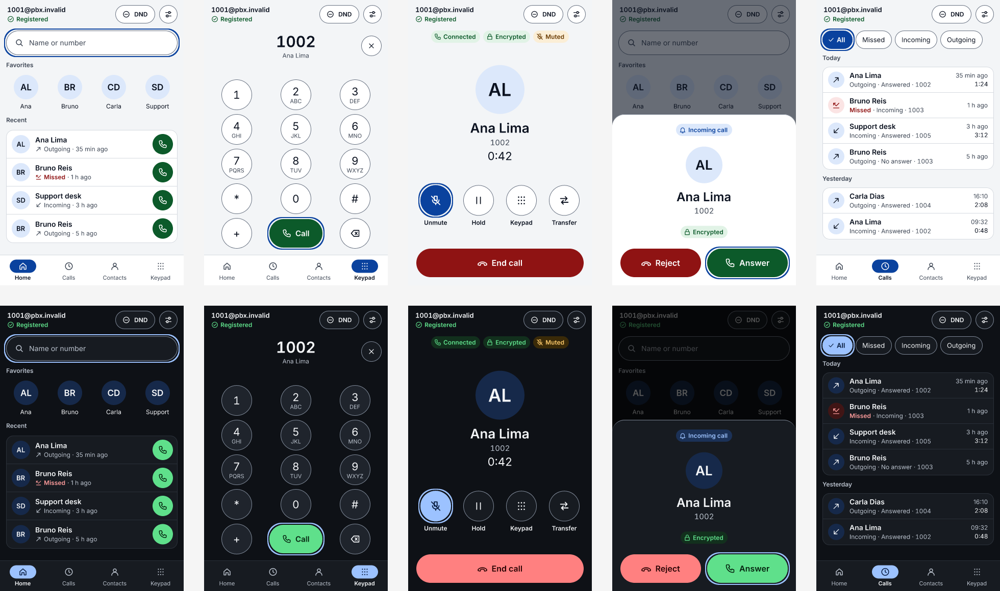
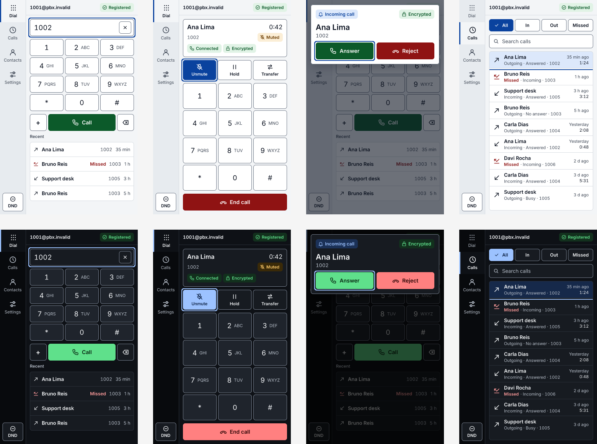

# Layout proposals for the go-microsip window (2026-11-11)

Three proposals for a more modern window that meets WCAG AAA contrast, for the owner to choose from. **Nothing here is implemented**: `frontend/src/`, the shipped skins and the backend contract (`frontend/src/api.ts`) are untouched, and no OpenSpec task is ticked by this work. The screens are drawings with fictional data (`pbx.invalid`, extensions 1001 to 1006), not screenshots of the application.

| | Layout | Idea | Corners |
| --- | --- | --- | --- |
| A | `a-classic` | Today's MicroSIP arrangement, refined | square (design D7 unchanged) |
| B | `b-call-first` | The call and the people first; the keypad is one destination among four | rounded (needs D7 changed) |
| C | `c-rail` | Dense: a side rail, and the keypad and recent calls on one screen | 6 px (needs D7 changed, or drawn square) |

Every layout is drawn at 360x560 in a light and a dark variant, with the same two palettes, so the three differ in structure and not in color.

## Files

| Path | What |
| --- | --- |
| `src/<layout>.figcraft` | The design source. Open it in FigCraft: every screen is a frame of auto layout boxes, text and vector icons, named after what it is. |
| `prints/<layout>/<screen>-<skin>.png` | One screenshot per screen, at 2x. |
| `prints/<layout>-overview.png` | All screens of a layout, light on the first row and dark on the second. |
| `contrast.md` | The measured contrast of every color pair, generated. |
| `generate.py`, `build.sh` | What draws them. |

The designs were built with [FigCraft](https://github.com/storytold/figcraft) 0.17.0 through its headless command line, `figcraft-cli`, which ships inside the FigCraft AppImage (`<AppImage> cli <arguments>`). `generate.py` writes one command script per layout (`node.create` with auto layout, `file.import` for the icons) and `build.sh` runs them with `figcraft-cli run`, then exports the frames. Text is set in Inter, a font built into FigCraft, with `--no-system-fonts`, so a rebuild gives the same pixels on any machine.

```sh
FIGCRAFT_CLI="/path/to/figcraft-0.17.0-linux-x86_64.AppImage cli" docs/ui/layouts/build.sh
```

To change a proposal, edit `generate.py` and rebuild; an edit made by hand in FigCraft is lost at the next rebuild.

## What the three share

- **Contrast.** Text is at least 7:1 on the color it is drawn on, and icons, control boundaries, selection markers and focus rings are at least 3:1. `generate.py` records each of these pairs as it draws and fails the build below those floors.
- **Focus.** A 2 px ring in the accent color, 2 px away from the control, on every kind of control (one focused control is drawn per screen).
- **States** are an icon and a label, never a color alone: Registered, Connected, Encrypted, Muted, Incoming call, Missed. A switched-on control changes its icon and its label as well as its fill (Mute becomes Unmute with a struck-out microphone), and the selected filter carries a check mark.
- **No disabled controls.** Today Call, End, Mute, Hold and Xfer are always on screen and greyed out when they do not apply. Here a control that does not apply is not drawn: End call takes the place of Call, and the in-call controls take the place of the editing ones.
- **Dark call buttons** are a light fill with dark text. White text on a green or red that is dark enough for 7:1 would not stand out from a dark window.
- **Icons** are the paths of `frontend/src/components/Icon.vue` with round caps and joins, plus two new ones drawn for this work (home and keypad).

### Measured contrast

Lowest ratio per layout and variant, from `contrast.md` (which lists every pair):

| Layout | Variant | Lowest text ratio | Lowest non-text ratio | Pairs checked |
| --- | --- | --- | --- | --- |
| A `a-classic` | light | 7.23 | 4.58 | 272 |
| A `a-classic` | dark | 7.23 | 5.20 | 272 |
| B `b-call-first` | light | 7.23 | 4.58 | 279 |
| B `b-call-first` | dark | 7.13 | 5.20 | 279 |
| C `c-rail` | light | 7.23 | 4.18 | 308 |
| C `c-rail` | dark | 7.13 | 4.75 | 308 |

Some of the pairs behind those figures:

| Pair | Light | Dark |
| --- | --- | --- |
| Text on the window | 17.13 | 17.30 |
| Secondary text on its least favorable background | 7.71 | 7.97 |
| Call button label on its fill | 8.36 | 9.99 |
| End call button label on its fill | 9.25 | 7.74 |
| Selected control label on the accent | 9.19 | 9.39 |
| State label on its tinted chip (lowest) | 7.23 | 7.13 |
| "Missed" on a selected row | 7.48 | 7.23 |
| Control border on the window | 4.58 | 5.20 |
| Focus ring on the window | 8.41 | 10.42 |

The ratios are computed with the WCAG formula from the exact colors the generator places, each against the fill of the box it sits in. They are not sampled from the exported pixels, where anti-aliasing blurs the edges of small text.

## A: `a-classic`



The window keeps its order: tabs with the menu at the right, the number, the keypad, the actions, the status bar. What changes:

- The tabs carry an icon and the selected one a 3 px marker; every row is taller (tabs 44, keys about 109x62, Call 48).
- An 88 px display area holds the number and the contact it matches while dialing, and the call (name, number, timer, state chips) during a call, so the keypad does not move when a call starts.
- One row serves two purposes: Delete, `+`, Clear while dialing; Mute, Hold, Transfer during a call. Call and End call share one wide button, with DND beside it.
- The incoming call stays a centered modal dialog with the focus on Answer.
- Calls: four filters, rows with the direction icon, the result in words and the age; search and Clear all at the bottom.

In `frontend/`: new values for the `light` and `dark` tokens, and new tokens for the tinted state chips, which every one of the six skins must then define (the token contract); `App.vue` (tab icons), `DialpadTab.vue` (display area, the shared rows, no disabled buttons), `CallPanel.vue` (chips), `CallsTab.vue` (rows), `Icon.vue` (round caps, keypad icon), `style.css` (sizes). `themes.test.ts` would raise its floor from 4.5 to 7 and add the 3:1 check of control borders. The keyboard walkthrough (`keyboard-check.sh`) stays valid apart from the buttons that are no longer drawn while disabled. **No change to D7**: corners are square.

Below 44x44 (WCAG 2.5.5, AAA target size): the editing and in-call rows (40 high), the filters (36 high) and the search row (40 high).

## B: `b-call-first`



Most calls go to a person the user has called before, so the first screen is people, not digits.

- **Home**: a search field that takes a name or a number, the favorites as a row of avatars, and the recent calls, each with its own Call button.
- **Bottom navigation** with four destinations: Home, Calls, Contacts, Keypad. The keypad has round 60 px keys, with `+`, Call and Delete on a fifth row.
- **Header**: the account, the registration state, DND and the settings button, on every screen.
- **Call**: the whole window. Avatar, name, number, timer, the state chips, four round controls (Mute, Hold, Keypad, Transfer) and a wide End call. Keypad opens the DTMF pad over this screen (not drawn).
- **Incoming call**: a sheet that rises from the bottom, Reject at the left and Answer at the right with the focus.
- **Calls**: filters as pills, the list grouped by day.

In `frontend/`: the largest change. `App.vue` (header and bottom navigation in place of tabs and the status bar; the menu's entries move behind the settings button), a new home view built from the existing `Contacts` and `History` queries, `DialpadTab.vue` as the keypad destination, `CallPanel.vue` as a full-window view with the DTMF pad as a second state, `Dialog.vue` (a sheet variant), `CallsTab.vue` (grouping by day), `keys.ts` (arrow keys in the navigation), and most of `keyboard-check.sh` and `prints.sh`. No change to `api.ts`: favorites already come first from `Contacts`.

**Needs D7 changed.** Round keys, pills and a 14 px card radius are the point of this layout. Design D7 ("Corners stay square in every skin") and the tests that enforce it (`--radius` must be `0` in `themes.test.ts`, and the `refine-native-ui` square-corner requirement it cites) would have to allow a radius per skin; `xp` and `win98` could keep `0`.

Below 44x44: the header buttons (36 high), the recent rows' Call buttons (40), the filter pills (36 high).

## C: `c-rail`



For a user who keeps the window open all day: the most on one screen.

- **Side rail** (68 px): Dial, Calls, Contacts, Settings, each an icon over a label, and DND at the bottom. Settings becomes a destination instead of a menu entry.
- **Header** of the content: the account and the registration chip.
- **Dial**: the number with a clear button, a compact keypad (keys about 88x44, letters beside the digit as today), `+`, Call and Delete on one row, and the four most recent calls below, so redialing needs no tab change.
- **Call**: a card with the name, timer, number and chips, a row of Mute, Hold, Transfer, the DTMF keypad and End call.
- **Incoming call**: a dialog across the top of the window, Answer with the focus.
- **Calls**: nine two-line rows on one screen, with the filters and the search above them.

In `frontend/`: `App.vue` (rail in place of the tabs, the menu and the status bar; the menu's other entries need a place, most likely the Settings view), `DialpadTab.vue` (compact keypad and a recent list from `History`), `CallPanel.vue`, `CallsTab.vue` (denser rows), `Dialog.vue` (top placement), `keys.ts` (vertical arrow navigation). At the minimum window of 320x480 the rail leaves 252 px for the content, which was not drawn.

**D7**: drawn with a 6 px radius, which needs the same change as B. The structure does not depend on it; with `--radius: 0` the layout is unchanged.

Below 44x44: the recent rows (38 high), the filters (32 high), the search field (36 high) and the clear button in the number field (32x32). In the recent list on the dial screen the direction of a call is an icon without a visible label (it needs an accessible name); "Missed" is written out.

## What the current interface lacks for AAA

Measured on the shipped tokens (`frontend/src/themes/*.css`) with the 39 text pairs of `themes.test.ts`, which today asks for 4.5:1 (AA):

| Skin | Pairs below 7:1 | Lowest |
| --- | --- | --- |
| `light` | 16 of 39 | 5.02 |
| `dark` | 7 of 39 | 5.02 |
| `xp` | 15 of the 31 solid-color pairs | 5.25 |
| `macos` | 19 of the 30 solid-color pairs | 5.53 |
| `ubuntu` | 20 of the 38 solid-color pairs | 5.03 |
| `win98` | 8 of the 38 solid-color pairs | 5.60 |

- `light`, below 7:1: the Call label (5.02), the End label (6.47), the label on the accent (6.70), links and the ringing state (6.09 on the window, 6.70 on a panel), secondary text on the window (6.87) and on a hovered row (6.10), the active, secure, held, insecure, muted and error states on the window (5.88 to 6.64), and the error state on a panel (6.47).
- `dark`, below 7:1: the Call label (5.02), the label on the accent (5.17), the End label (6.47), secondary text on a hovered row (5.98) and on a panel (6.86), the letters on the keys (6.16), the muted state on a panel (6.62).
- **Control borders are below 3:1** in both: the border of buttons and fields against the window is 2.31 in `light` and 2.39 in `dark`, and the face of a key or a button differs from the window by 1.10 to 1.35. This misses WCAG 1.4.11 (level AA) for the number field, whose border is all that marks it.
- The text of disabled controls is exempt from the contrast rules and stays hard to read; the proposals remove the disabled controls instead.
- The icon colors of the status bar were not audited (`docs/ui/go-frontend.md` says so); the proposals audit every icon at 3:1.

The gradients of `xp` and `macos` were left out of the table above (their pairs are not solid colors).

## Not done, not verified

- Contacts, the contact editor, Settings, the menu, the agent approval dialog, the error and stopped states, and the transfer prompt are not drawn in any layout. The README says where each layout would put Settings and the menu; the rest would follow the pattern of the screens shown.
- Only `light` and `dark` are proposed. What `xp`, `macos`, `ubuntu` and `win98` look like in each structure, and whether they are raised to 7:1 too, is open.
- The minimum window (320x480), 150 % and 200 % scaling, and long or hostile caller names were not drawn.
- These are static drawings: hover and pressed states, keyboard order and screen-reader names are described, not tested. Nothing ran in the webview.
- Inter is FigCraft's built-in font. The application uses the system font stack and bundles no font (task 5.4), so the real window would differ slightly in letter widths.
- The contrast figures come from the colors as placed, not from the exported pixels.
